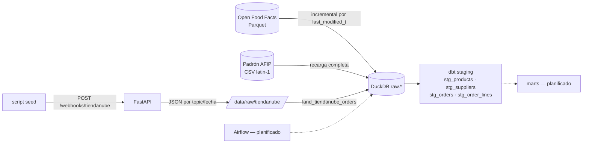

🌐 [English](README.md) · **Español**

# Retail Analytics E2E

[](https://github.com/Mrcipo/Retail-Analytics-E2E/actions/workflows/ci.yml)


[](LICENSE)

Pipeline de analítica retail de punta a punta sobre un stack local: ingesta en Python → DuckDB → dbt,
con orquestación en Airflow planificada. Combina tres fuentes: un catálogo de productos (Open Food
Facts), un padrón de proveedores (padrón de contribuyentes de AFIP) y órdenes de e-commerce recibidas
como webhooks estilo Tiendanube.

> **Estado: etapa temprana.** La ingesta y la capa staging de dbt funcionan. Los marts de dbt (hechos,
> dimensiones, snapshots SCD Tipo 2) y los DAGs de Airflow todavía no están construidos. Las órdenes son
> **sintéticas**: las genera `extraction/seed_tiendanube_webhooks.py` y las envía a la API local de
> webhooks; no vienen de una tienda real.

## Arquitectura



| Componente | Archivo | Qué hace |
|------------|---------|----------|
| Ingesta Open Food Facts | `extraction/openfoodfacts_ingest.py` | Descarga el Parquet (con reanudación), lo escanea en modo lazy con Polars y hace upsert en `raw.off_products` solo de las filas modificadas después del watermark guardado. Por ahora limitado a 1.000 filas por corrida mientras se valida. |
| Ingesta AFIP | `extraction/afip_ingest.py` | Lee un CSV del padrón descargado a mano (`;`, latin-1, todas las columnas como texto) y reemplaza `raw.afip_padron`. |
| API de webhooks | `api/` | `POST /webhooks/tiendanube` valida el topic y guarda cada payload como JSON particionado por topic y fecha (capa bronze). |
| Landing de órdenes | `extraction/land_tiendanube_orders.py` | Aplana los webhooks de órdenes en `raw.tiendanube_orders` (última versión de cada orden) y `raw.tiendanube_order_lines`. |
| Tabla de control | `extraction/utils/db.py` | `control.ingestion_watermarks` registra watermark, última corrida y cantidad de filas de cada fuente. |
| Staging dbt | `dbt/retail_analytics/models/staging/` | Renombra, castea y limpia cada tabla raw; tests de claves unique/not-null y de FK de las líneas de orden. |

## Inicio rápido

```bash
python -m venv venv
source venv/bin/activate          # Windows: venv\Scripts\activate
pip install -r requirements.txt
cp .env.example .env
```

### Probarlo con datos de ejemplo (sin descargas)

```bash
export DUCKDB_PATH=$PWD/data/sample.duckdb
python -m scripts.create_sample_db      # tablas raw.* sintéticas, mismo esquema que las ingestas reales
cd dbt/retail_analytics
DBT_PROFILES_DIR=. dbt build            # modelos staging + tests de datos
```

### Con las fuentes reales

```bash
python extraction/openfoodfacts_ingest.py         # descarga grande en la primera corrida
python extraction/afip_ingest.py                  # espera data/raw/afip/padron_afip.csv
uvicorn api.main:app --reload                     # API de webhooks en :8000
python -m extraction.seed_tiendanube_webhooks     # envía ~80 órdenes sintéticas
python -m extraction.land_tiendanube_orders       # JSON de webhooks -> raw.tiendanube_*
cd dbt/retail_analytics && DBT_PROFILES_DIR=. dbt build
```

dbt lee la base desde `DUCKDB_PATH` (por defecto `../../data/retail_analytics.duckdb`, relativo a
`dbt/retail_analytics`).

## Tests

```bash
pytest
```

Los tests unitarios cubren la API de webhooks (persistencia por topic/fecha, validación de topic, JSON
inválido) y el landing de órdenes (aplanado, registros mal formados, conservar la última versión de cada
orden, actualización del watermark). El CI además arma la base de ejemplo y corre `dbt build`, así que
todos los modelos staging y tests de dbt se verifican en cada push.

## Próximos pasos

- [ ] Modelos intermedios y marts de dbt (`fact_orders`, `dim_products`, `dim_suppliers`)
- [ ] Snapshots SCD Tipo 2 para productos y proveedores
- [ ] DAGs de Airflow para ingesta + dbt
- [ ] Quitar el límite de 1.000 filas en la ingesta de Open Food Facts

## Licencia

Publicado bajo la [Licencia MIT](LICENSE). Los datos de Open Food Facts están bajo licencia
[ODbL](https://world.openfoodfacts.org/terms-of-use).
