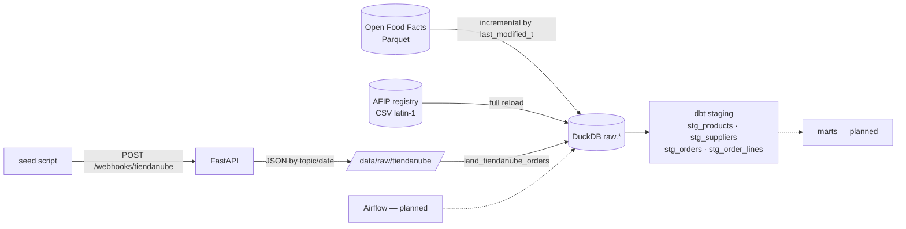

🌐 **English** · [Español](README.es.md)

# Retail Analytics E2E

[](https://github.com/Mrcipo/Retail-Analytics-E2E/actions/workflows/ci.yml)


[](LICENSE)

An end-to-end retail analytics pipeline built on a local stack: Python ingestion → DuckDB → dbt, with
Airflow orchestration planned. It combines three sources — a product catalogue (Open Food Facts), a
supplier registry (Argentina's AFIP taxpayer list) and e-commerce orders received as Tiendanube-style
webhooks.

> **Status: early stage.** Ingestion and the dbt staging layer work. The dbt marts (facts, dimensions,
> SCD Type 2 snapshots) and the Airflow DAGs are not built yet. Orders are **synthetic**: they are
> generated by `extraction/seed_tiendanube_webhooks.py` and posted to the local webhook API, not pulled
> from a real store.

## Architecture



| Component | File | What it does |
|-----------|------|--------------|
| Open Food Facts ingest | `extraction/openfoodfacts_ingest.py` | Downloads the Parquet (with resume), scans it lazily with Polars and upserts only rows modified after the stored watermark into `raw.off_products`. Currently capped at 1,000 rows per run while it is being validated. |
| AFIP ingest | `extraction/afip_ingest.py` | Reads a manually downloaded registry CSV (`;`, latin-1, all columns as text) and replaces `raw.afip_padron`. |
| Webhook API | `api/` | `POST /webhooks/tiendanube` validates the topic and stores each payload as JSON partitioned by topic and date (bronze layer). |
| Order landing | `extraction/land_tiendanube_orders.py` | Flattens the order webhooks into `raw.tiendanube_orders` (latest version per order) and `raw.tiendanube_order_lines`. |
| Control table | `extraction/utils/db.py` | `control.ingestion_watermarks` records the watermark, last run and row count for every source. |
| dbt staging | `dbt/retail_analytics/models/staging/` | Renames, casts and trims each raw table; tests for unique/not-null keys and order-line foreign keys. |

## Quick start

```bash
python -m venv venv
source venv/bin/activate          # Windows: venv\Scripts\activate
pip install -r requirements.txt
cp .env.example .env
```

### Try it with sample data (no downloads)

```bash
export DUCKDB_PATH=$PWD/data/sample.duckdb
python -m scripts.create_sample_db      # synthetic raw.* tables, same schema as the real ingests
cd dbt/retail_analytics
DBT_PROFILES_DIR=. dbt build            # staging models + data tests
```

### With the real sources

```bash
python extraction/openfoodfacts_ingest.py         # large download on first run
python extraction/afip_ingest.py                  # expects data/raw/afip/padron_afip.csv
uvicorn api.main:app --reload                     # webhook API on :8000
python -m extraction.seed_tiendanube_webhooks     # posts ~80 synthetic orders
python -m extraction.land_tiendanube_orders       # webhooks JSON -> raw.tiendanube_*
cd dbt/retail_analytics && DBT_PROFILES_DIR=. dbt build
```

dbt reads the database from `DUCKDB_PATH` (default `../../data/retail_analytics.duckdb`, relative to
`dbt/retail_analytics`).

## Tests

```bash
pytest
```

Unit tests cover the webhook API (persistence by topic/date, topic validation, invalid JSON) and order
landing (flattening, malformed records, keeping the latest version of each order, watermark update).
CI also builds the sample database and runs `dbt build`, so every staging model and dbt test is checked
on each push.

## Roadmap

- [ ] dbt intermediate and mart models (`fact_orders`, `dim_products`, `dim_suppliers`)
- [ ] SCD Type 2 snapshots for products and suppliers
- [ ] Airflow DAGs for ingestion + dbt
- [ ] Remove the 1,000-row cap on the Open Food Facts ingest

## License

Released under the [MIT License](LICENSE). Open Food Facts data is available under the
[ODbL](https://world.openfoodfacts.org/terms-of-use).
